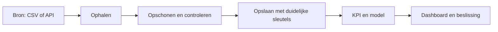

# Begrippen begrijpen: van bron tot beslissing

[Terug naar de leerroute](README.md)

Lees dit niet als een woordenlijst die je moet opzeggen. Vraag bij ieder begrip:
**waar zie ik dit in mijn project, welk probleem lost het op en wat kan er fout gaan?**
De codewandeling maakt onderscheid tussen bestaande code en uitbreidingen.

## 1. Het volledige verhaal

Een databron levert gebeurtenissen of metingen. Je haalt ze op, controleert de
vorm en betekenis, bewaart ze op een afgesproken detailniveau, berekent een KPI
en toont die aan iemand die een beslissing moet nemen. Een bruikbaar dashboard
begint daarom bij een zakelijke vraag: wie gaat op basis van dit getal wat doen?



Dit is een algemeen schema, geen bewijs dat iedere repo al deze stappen in één
automatische keten uitvoert. Lees daarvoor de lokale codewandeling.

## 2. ETL, ELT en orchestration

| Begrip | Gewone taal | Vraag die je moet kunnen beantwoorden |
|---|---|---|
| Extract | Gegevens ophalen uit een bron | Wat haal ik op, wanneer en met welke toestemming? |
| Transform | Vorm of betekenis bruikbaar maken | Welke rij verander ik, verwijder ik of keur ik af? |
| Load | Gegevens naar een bestemming schrijven | Vervang ik data, werk ik ze bij of bewaar ik historie? |
| ETL | Eerst verwerken, daarna laden in de doelstructuur | Waarom gebeurt de verwerking buiten de doelopslag? |
| ELT | Eerst laden, vervolgens in de dataomgeving verwerken | Hoe bescherm ik de ruwe laag en maak ik afgeleide tabellen? |
| Pipeline | Samenhangende verwerkingsstappen | Wat gebeurt er als stap drie mislukt? |
| Orchestration | Volgorde, afhankelijkheden en uitvoering regelen | Welke stap mag pas starten als een andere klaar is? |
| Schedule | Afspreken wanneer een run start | Wat gebeurt er als een run langer duurt dan het interval? |
| Retry | Tijdelijk mislukte stap nogmaals proberen | Is opnieuw proberen veilig en heeft het kans van slagen? |
| Backfill | Een ontbrekende historische periode alsnog verwerken | Welke periode, bronversie en regels gebruik ik? |

Een netwerkonderbreking kan een retry rechtvaardigen. Een ontbrekende verplichte
kolom los je daarmee niet op. Beperk pogingen en wachttijd; zorg dat falen zichtbaar
blijft. Een geslaagde geplande workflow kan de echte verwerking hebben overgeslagen.
Lees daarom ook de logs en controleer nieuwe gegevens.

## 3. Opslag en sleutels

**Grain** betekent: wat stelt precies één rij voor? Bijvoorbeeld één aankoop,
één station op één meetmoment, of één sensor plus tijdstip plus meettype. Schrijf
dit op vóór je een tabel maakt. Zonder grain weet je niet of twee rijen dubbel zijn.

Een **primary key** identificeert een rij uniek. Een **foreign key** verwijst naar
een rij in een andere tabel. Een **business key** is een herkenbare sleutel uit de
bron. Een **surrogate key** is een intern toegekende sleutel, bijvoorbeeld voor
verschillende historische versies van dezelfde klant.

| Schrijfstrategie | Voorbeeld | Belangrijk gevolg |
|---|---|---|
| Full refresh | Hele lokale verkooptabel opnieuw vullen | Eenvoudig, maar je vervangt de vorige inhoud |
| Append | Iedere nieuwe meting toevoegen | Historie groeit; dubbele levering moet je afhandelen |
| Upsert | Bestaande sleutel bijwerken, nieuwe sleutel toevoegen | Vorige waarden kunnen verdwijnen |
| Snapshot | Toestand op een vastgelegd moment bewaren | Een nieuwe toestand is een nieuwe rij |

**Idempotent**: dezelfde logische invoer opnieuw verwerken verandert het bedoelde
eindresultaat niet nogmaals. Twee keer dezelfde verkoop laden hoort geen dubbele
omzet te maken. Maar twee metingen op verschillende tijdstippen zijn verschillende
invoer, ook als de waarden gelijk zijn. Leg vast welke sleutel herhaling herkent.

Een **transactie** bundelt databasewijzigingen: commit bij succes, rollback bij
falen. Twee aparte transacties in dezelfde pipeline zijn samen niet automatisch
één transactie. Een half bijgewerkte keten blijft dus mogelijk.

## 4. SQL lezen en over tellingen nadenken

```sql
-- Denkvoorbeeld: sales heeft één rij per order.
SELECT country, SUM(revenue) AS total_revenue, COUNT(*) AS orders
FROM sales
WHERE revenue > 0
GROUP BY country
HAVING COUNT(*) >= 2
ORDER BY total_revenue DESC;
```

Lees dit als: neem sales, houd positieve omzet over, vorm groepen per land,
bereken per groep omzet en rijtelling, houd groepen met minimaal twee rijen,
sorteer het resultaat. `WHERE` filtert rijen; `HAVING` filtert groepen.
`COUNT(*)` telt rijen; `COUNT(column)` telt niet-lege waarden; een telling van
unieke order-ID's telt orders als een order uit meerdere rijen bestaat.

**JOIN** combineert rijen. Verkoop €100 gekoppeld aan twee passende klantrecords
wordt twee resultaatrijen van €100. De som €200 is dan een modelfout, geen extra
verkoop. Controleer vóór en na de join rijtelling, unieke sleutels en totaalsom.
Een inner join verwijdert rijen zonder match; een left join bewaart de linkerkant
en laat ontbrekende context leeg. Beide kunnen ongewenst zijn als je niet controleert.

**Window functions** berekenen iets over een groep zonder alle detailrijen samen
te voegen. Een volgnummer per klant is een ander resultaat dan één totaal per klant.
Bij gelijke sorteertijden is een extra sorteersleutel nodig voor een voorspelbare keuze.

**NULL** betekent ontbrekend/onbekend, niet automatisch nul. Geen meting ontvangen
is iets anders dan nul fietsen beschikbaar. Een ontbrekende waarde opvullen met nul
is een inhoudelijke beslissing die je aan de gebruiker moet kunnen uitleggen.

## 5. Python-code lezen

Begin bij de ingang van het programma, volg de aangeroepen functies en schrijf
voor iedere stap drie dingen op: invoer, wijziging, uitvoer.

| Code-element | Wat je moet herkennen |
|---|---|
| Variabele | Naam die naar een waarde of object verwijst |
| Functie | Afgebakende bewerking met argumenten en een resultaat of bijwerking |
| List / dictionary | Verzameling items / waarden met namen als sleutel |
| DataFrame | Tabel in het geheugen waarop bewerkingen plaatsvinden |
| Filter | Een selectie van rijen; controleer hoeveel rijen verdwijnen |
| Grouping | Rijen samenbrengen om bijvoorbeeld sommen te berekenen |
| Exception | Foutsignaal; zoek oorzaak en invoer, niet alleen de laatste foutregel |
| Return | Waarde teruggeven; dit schrijft niet vanzelf naar een database |
| Side effect | Bestand schrijven, database wijzigen of een API-aanroep uitvoeren |
| Type | Soort waarde: tekst, getal, datum, boolean; conversie kan betekenis verliezen |

Je hoeft niet ieder argument uit je hoofd te kennen. Je moet wel kunnen voorspellen
wat drie kleine invoerrijen opleveren. Als je dat niet kunt, maak de invoer kleiner.

## 6. Datamodellering en semantiek

Een **feitentabel** bevat gebeurtenissen of metingen. Een **dimensie** beschrijft
context: wie, wat, waar, wanneer. Een **stermodel** koppelt meerdere dimensies aan
een centrale feitentabel. Unieke dimensiesleutels voorkomen onbedoelde vermenigvuldiging.

Bij **SCD type 1** overschrijf je een gewijzigde beschrijving. Bij **SCD type 2**
bewaar je versies met geldigheidsperiodes. Niet elke repo met een dimensietabel
heeft historische dimensies geïmplementeerd. Vraag of een rapport de context van
toen of de huidige context moet tonen.

Een **semantisch model** legt vast hoe tabellen, relaties en berekeningen als
zakelijke begrippen samenhangen. Een dashboard tekent de resultaten daarvan.
SQL-tabellen of een dashboard op zichzelf bewijzen geen uitgewerkt Power BI-model.

**Measure**: berekening die binnen een selectie wordt geëvalueerd. Bijvoorbeeld
omzet voor het gekozen land en de gekozen maand. **Filtercontext** is die selectie.
**DAX** is de formule-/querytaal voor onder meer Power BI-modellen. **Power Query**
wordt gebruikt voor data-inname en transformatie. Dit zijn leerbegrippen; een
Python-dashboard is geen bewijs dat je deze hulpmiddelen al beheerst.

## 7. KPI's, statistiek en zakelijke afspraken

Leg bij een KPI vast: naam, vraag, formule, grain, eenheid, periode/tijdzone,
filters, uitzonderingen, eigenaar, bron en gewenste actualiteit.

Voorbeeld: omzet is hier aantal × prijs. In een bedrijf moet je nog bepalen of
btw, korting, annuleringen en retouren meetellen. Een correcte vermenigvuldiging
kan dus toch het verkeerde zakelijke antwoord geven.

**Ratio's moet je meestal opnieuw uit totalen berekenen.** Bij €100 omzet en €50
winst plus €900 omzet en €90 winst is de totale marge 140/1000 = **14%**.
Het gemiddelde van 50% en 10% is 30% en geeft hier een verkeerd totaalbeeld.

Gemiddelde en mediaan beantwoorden verschillende vragen: enkele extreme waarden
kunnen het gemiddelde sterk verschuiven. Een percentiel toont een grens in een
verdeling. Een anomalie is een signaal om te onderzoeken, niet automatisch een fout.
Een correlatie bewijst geen oorzaak. Een zelfbedachte score is geen gemeten gedrag.

Bij voorspellen scheid je verleden om te leren van latere data om te beoordelen.
**Data leakage** betekent dat informatie die op het voorspelmoment niet beschikbaar
was toch in de voorspelling terechtkomt. Vergelijk fouten met een eenvoudige
baseline en controleer of synthetische data je resultaat te gemakkelijk maken.

## 8. Kwaliteit, governance en beveiliging

| Aspect | Concrete controle |
|---|---|
| Volledigheid | Hoeveel van de verwachte records of velden zijn aanwezig? |
| Uniciteit | Is iedere afgesproken sleutel uniek? |
| Geldigheid | Zijn type, bereik en formaat toegestaan? |
| Consistentie | Spreken velden of bronnen elkaar tegen? |
| Actualiteit | Hoe oud is de laatste bruikbare bronmeting? |
| Juistheid | Komt de waarde overeen met de werkelijkheid of een betrouwbare referentie? |

Een geldig getal is niet automatisch een juist getal. Test daarom ook tegen
handmatig narekenbare voorbeelden en broncontroles.

**Metadata** beschrijft gegevens: betekenis, eenheid, eigenaar, bron en tijdstip.
**Lineage** beschrijft de herkomst en bewerkingen. Alleen een `extracted_at`-veld
is nog geen volledig systeem voor lineage. Bewaar zo mogelijk ook bron-ID,
run-ID, codeversie en aantallen per stap.

**Governance** zijn afspraken over eigenaarschap, toegang, definities, bewaartermijnen
en wijzigingen. Een business-eigenaar keurt de KPI-betekenis goed; een technisch
beheerder bewaakt de uitvoering. Toegangsrechten moeten passen bij iemands taak.

Secrets horen buiten Git en buiten screenshots/logs. Een verborgen knop of een
dashboardfilter is geen autorisatie. **RLS** beperkt welke rijen een gebruiker
mag zien; controleer met verschillende rollen of de beperking werkelijk geldt.
Met synthetische oefendata toon je geen volledige privacy-implementatie aan.

## 9. Prestaties, testen en levering

Meet eerst: welke stap kost tijd, hoeveel rijen/geheugen zijn betrokken en wat
moet de gebruiker kunnen? Daarna pas optimaliseren. Mogelijke maatregelen zijn
eerder filteren, minder kolommen lezen, in batches verwerken, passende indexen
of vooraf aggregeren. Een index helpt bepaalde leesvragen maar kost opslag en
schrijfwerk. Rij-voor-rij verwerken kan bij grotere aantallen duur worden.

**Cache** hergebruikt een eerder resultaat. Vraag altijd wanneer dat resultaat
vervalt. Snelle oude gegevens zijn niet hetzelfde als snelle actuele gegevens.

| Controle | Bewijst vooral | Bewijst niet vanzelf |
|---|---|---|
| Unit test | Een kleine berekening doet wat afgesproken is | Dat een echte databron beschikbaar is |
| Integration test | Onderdelen praten werkelijk met elkaar | Dat alle zakelijke scenario's kloppen |
| End-to-end test | Een hele route werkt in de geteste situatie | Dat iedere toekomstige run slaagt |
| Reconciliatie | Bron- en doeltotalen zijn verklaarbaar | Dat de bron inhoudelijk juist is |
| Lint/typecheck | Bepaalde codeproblemen worden gevonden | Dat een KPI zakelijk correct is |

**CI** voert afgesproken controles uit na wijzigingen. **CD** automatiseert levering
of deployment. Een groen vinkje is alleen bewijs voor de uitgevoerde controles;
bekijk skips en logs. Versiebeheer bewaart wijzigingen, maar vervangt geen
databasebackup of herstelplan. Rollback van code maakt een datamigratie niet
automatisch ongedaan.

## 10. Van zakelijke vraag naar acceptatie

Werk in deze volgorde:

1. Vraag wie een beslissing moet nemen en wat nu lastig is.
2. Leg definitie, periode, detailniveau en uitzonderingen vast.
3. Maak een voorbeeld met drie tot vijf rijen en een handmatig verwacht antwoord.
4. Bepaal bron en kwaliteitsvoorwaarden.
5. Bouw de kleinste route naar het antwoord.
6. Vergelijk uitkomst met het voorbeeld en laat de eigenaar de betekenis beoordelen.
7. Leg actualiteit, beperkingen, beheer en herstel vast.

Voorbeeld van acceptatie: “Met deze drie verkoopregels toont de kaart €150 omzet;
na selectie van België €100. Een onbekend land verdwijnt niet stilzwijgend maar
wordt zichtbaar in een kwaliteitsrapport.” Dat is toetsbaarder dan “een goed dashboard”.

## Bronnen en afbakening

Dit hoofdstuk legt algemene concepten uit. De codewandeling is gebaseerd op de
lokale repositorycode, nagekeken op 11 oktober 2026. Voor Fabric is officiële
Microsoft-documentatie via Context7 geraadpleegd op dezelfde datum:

- [Medallion en OneLake-architectuur](https://learn.microsoft.com/en-us/fabric/onelake/architecture-patterns)
- [Semantische modellen maken](https://learn.microsoft.com/en-us/fabric/data-warehouse/create-semantic-model)
- [RLS beheren](https://learn.microsoft.com/en-us/fabric/security/service-admin-row-level-security)

Dit document is geen installatiehandleiding en claimt geen uitgevoerde clouddeployment.
