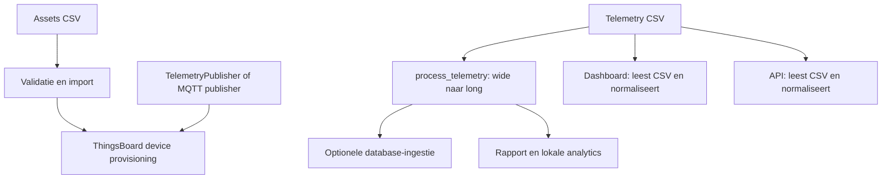

# Volg een sensor en zijn metingen

[Leerroute](README.md) · [Oefeningen](oefeningen.md)

## 1. Zakelijke vraag

“Welke sensoren leveren bruikbare data en waar moeten we een afwijking onderzoeken?”
De operator wil weten waar een sensor staat, wat die meet, of er gegevens
ontbreken en welke waarden aandacht vragen. Een opvallende meting kan een echte
gebeurtenis, een kapotte sensor of een verwerkingsfout zijn.

## 2. Vier routes uit elkaar houden



Er staat in deze route geen automatische pijl van ThingsBoard naar de lokale
dashboard-CSV's. Een realistische architectuurtekening in de README is geen
bewijs dat iedere stap door één uitvoerbaar commando wordt verbonden.

## 3. Een asset registreren

Een asset is de beschrijving van een sensor: ID, project, type, plaats,
coördinaten en serienummer. Dit is iets anders dan een meetwaarde.

[csv_importer.py](../../src/sensor_platform/imports/csv_importer.py) leest
assetregels in chunks, valideert ze, zet geldige regels om naar devices en
laat de provisioner ze verwerken. Een set van al geziene sensor-ID's helpt
dubbels tussen chunks herkennen.

Een import telt `created`, `updated`, `unchanged` en `rejected`. Bij een
ongewijzigde herhaling wil je vooral `unchanged` zien. Dit wordt in
[devices.py](../../src/sensor_platform/integrations/thingsboard/devices.py)
op basis van de devicenaam en attributen bepaald.

Chunking beperkt de grootte van de ingelezen batch, maar de set van geziene
ID's groeit mee met het aantal unieke sensoren. Bovendien gaat de latere
telemetrie-ingestie niet via dezelfde chunkingroute. Zeg dus niet dat alle
verwerking in deze repo een constant geheugengebruik heeft.

## 4. Communicatie en toegang

De managementclient gebruikt een gebruiker-login en JWT voor beheertaken.
De telemetriepublisher gebruikt een device-token voor het versturen namens een
sensor. Deze scheiding staat in de lokale integratiecode. Een device-token
hoort niet als algemeen beheerderswachtwoord te worden behandeld.

[client.py](../../src/sensor_platform/integrations/thingsboard/client.py)
probeert bepaalde tijdelijke fouten opnieuw met oplopende wachttijd. Na 401
wordt eenmaal opnieuw ingelogd. Dit lost een verkeerde configuratie of blijvend
ontbrekende rechten niet op. Niet alle schrijfresponses in de provisioner worden
even expliciet gecontroleerd; een teruggegeven “updated” is daarom niet op zichzelf
bewijs dat iedere downstream-schrijfstap slaagde. Bekijk foutafhandeling per pad.

## 5. Eén telemetrieregel veranderen

Ruwe, brede invoer:

| sensor_id | timestamp | temperature | humidity |
|---|---|---:|---:|
| S1 | 2026-10-11T08:00:00Z | 20 | 60 |

Na [process_telemetry()](../../src/sensor_platform/ingestion/processor.py):

| sensor_id | timestamp | metric | value |
|---|---|---|---:|
| S1 | 2026-10-11T08:00:00Z | temperature | 20 |
| S1 | 2026-10-11T08:00:00Z | humidity | 60 |

Dit heet **wide naar long**: meettypes worden rijen in plaats van kolommen.
De code zet tijd naar UTC, verwijdert exact gelijke brede rijen, herschikt
de tabel en verwijdert ontbrekende meetwaarden.

Twee meetrijen betekenen hier niet twee sensoren of twee meetmomenten. Het grain
is `(sensor_id, timestamp, metric)`. De grootte van het long-resultaat hangt
af van het aantal niet-lege metrieken per tijdstip.

## 6. Exact dubbel is iets anders dan conflicterend

De eerste deduplicatie vergelijkt **alle kolommen**. Twee brede rijen met
dezelfde sensor/tijd maar verschillende temperatuur blijven dus allebei bestaan.
Na normalisatie kunnen zij dezelfde logische meetsleutel hebben.

De databasecode maakt een ID uit sensor, tijd en meettype. Herhaalde writes
werken een bestaande sleutel bij. Een conflict kan zo in de database op één
waarde eindigen, terwijl een rechtstreeks op CSV gebaseerde analyse beide
waarden nog bevat. Kies expliciet een conflictregel, bijvoorbeeld een betrouwbare
bronversie of het afzonderlijk registreren van conflicten. De documentatie
implementeert die regel nog niet.

## 7. Database en rapport hebben verschillende ingangen

[pipeline.py](../../src/sensor_platform/ingestion/pipeline.py) kan CSV
normaliseren en in PostgreSQL schrijven. `write_telemetry()` maakt eerst een
lijst ORM-records en verwerkt die met `session.merge()` per record in een sessie.
Dat ondersteunt herhaald schrijven op dezelfde sleutel, maar bewijst geen
optimale bulkperformance bij miljoenen meetwaarden.

[scripts/generate_report.py](../../scripts/generate_report.py) leest zelf
assets en telemetrie uit CSV, normaliseert en roept de rapportgenerator aan.
[dashboard/app.py](../../dashboard/app.py) doet eveneens CSV-inname.
[api/data.py](../../src/sensor_platform/api/data.py) cachet CSV-data per pad.
De dashboards en API zijn dus niet automatisch databaselezers.

## 8. Wat de kwaliteitscijfers werkelijk betekenen

In [quality.py](../../src/sensor_platform/analytics/quality.py) staan grenzen
voor onder andere temperatuur, vochtigheid en pH. Ze zijn projectregels voor
controle; behandel ze niet als officiële gezondheids- of wettelijke grenswaarden.
Een onbekende metriek heeft hier geen bereikcontrole.

`completeness_pct` wordt berekend als:

```text
100 × (1 − aantal buiten bereik / aantal aanwezige long-meetrijen)
```

Dat meet hier het aandeel aanwezige waarden dat niet buiten bereik is, **niet
de volledigheid ten opzichte van alle verwachte metingen**. Bij 100 geldige
ontvangen metingen en 100 ontbrekende kan dit nog steeds 100% zijn. Ook een lege
dataset krijgt in deze specifieke berekening 100%. Een label moet overeenkomen
met zijn formule; deze naam is dus een leerpunt.

`sensor_uptime()` schat dichtheid van unieke tijdstippen tussen eerste en laatste
ontvangen meting. Het kent geen extern afgesproken volledig meetvenster. Een
sensor die vroeg volledig uitvalt, hoeft daarom niet correct als offline over
de resterende periode te worden meegeteld. De verwachte telling gebruikt span / interval,
zonder expliciete inclusieve eindpuntcorrectie. Een productie-KPI moet dat preciezer bepalen.

`detect_missing_intervals()` markeert gaten **groter dan** tweemaal het interval.
Bij 15 minuten is een gat van exact 30 minuten dus geen gemarkeerd gat.

## 9. Analyse en rapportering

[aggregation.py](../../src/sensor_platform/analytics/aggregation.py)
groepeert per sensor, meettype en uur. Een projectoverzicht koppelt metingen
aan `project_id` via assets. Dubbele assets kunnen zo metingen vermenigvuldigen;
een sensor zonder projectmatch kan uit de gegroepeerde projectsamenvatting vallen.

Gemiddelde waarden over alle metingen wegen sensoren met meer aanwezige records
zwaarder. Dat is niet vanzelf hetzelfde als het gemiddelde van sensorgemiddelden.
Leg vast welk antwoord de gebruiker nodig heeft.

Anomaliedetectie geeft onderzoekssignalen. “Afwijkend van deze dataset” en
“buiten een ingestelde grens” zijn verschillende beoordelingen. Een stabiel maar
verkeerd gekalibreerde sensor hoeft statistisch niet sterk af te wijken.

## 10. Cache, tests en bewijskracht

De API-cache is op bestandspaden gebaseerd, niet op bestandstijd of inhoud.
Een CSV vervangen op hetzelfde pad maakt die cache niet vanzelf ongeldig;
`clear_cache()` bestaat als expliciete functie. Ook het lokale dashboard heeft
een gecachte laadfunctie zonder bestandversie-argument.

Mocktests testen gedrag met nagebootste services. Integratietests hebben echte
services en configuratie nodig en kunnen worden overgeslagen. Controleer daarom
de uitgevoerde testnamen, skips en omgeving vóór je zegt dat de echte integratie
werkt. CI-bestanden zijn een uitvoeringsplan; een actuele run is apart bewijs.

## 11. Je eigen uitleg

“De repo bevat afzonderlijke routes voor sensorregistratie, telemetrieopslag en
CSV-gebaseerde analyse. Ik kan een brede meetrij omzetten naar losse metrieken
en de unieke meetsleutel uitleggen. Ik controleer ook of een kwaliteitslabel
werkelijk de gewenste eigenschap meet. Volledigheid en uptime moeten preciezer
worden gedefinieerd voordat ik daar productieclaims aan verbind.”
